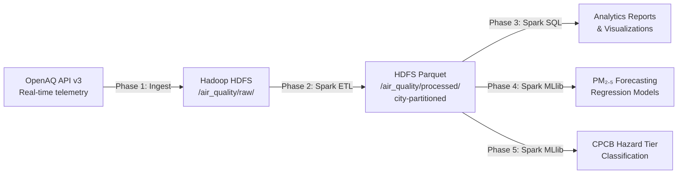

# Distributed Urban Air Quality Analytics & AQI Forecasting

> A production-grade Big Data pipeline that ingests real-time ambient air quality telemetry from Indian cities, computes CPCB-compliant AQI at scale using Apache Spark, and forecasts 24-hour PM₂.₅ levels with distributed Spark MLlib models.


---

## About the Project

Urban air pollution is a major public health crisis in India, with cities like Delhi NCR recording PM₂.₅ concentrations more than ten times WHO safe limits. Real-time monitoring data exists, but processing it at scale — and predicting future hazard levels — requires a distributed data engineering approach.

This project builds an end-to-end **Big Data system** that:

- **Ingests** continuous hourly telemetry from real CAAQMS monitoring stations via the OpenAQ API v3.
- **Stores** raw and processed data in **Hadoop HDFS** with fault-tolerant replication.
- **Transforms** pollutant readings using **Apache Spark**, applying official CPCB NAQI regulatory methodology.
- **Analyzes** city-level and station-level air quality trends using **Spark SQL**.
- **Forecasts** 24-hour ahead PM₂.₅ concentrations and predicts CPCB health hazard tiers using **Spark MLlib**.

The system covers three Indian cities — **Delhi NCR**, **Bengaluru**, and **Hyderabad** — using ~96,000 real hourly sensor readings (~47 MB of raw telemetry) from 4 CAAQMS stations.

---

## Key Features

- **Resumable API ingestion** with checkpointing, rate-limit compliance (60 req/min), exponential backoff, and deduplication
- **HDFS data lake** with three data zones: raw JSON, processed Parquet (partitioned by city), and analytics output
- **Regulatory CPCB NAQI engine** (`cpcb_aqi.py`) implementing official Indian AQI breakpoints, 16-hour validity rules, and composite AQI using the maximum-sub-index operator
- **Unit harmonization** (ppb → µg/m³) and temporal aggregation into station-hour time series
- **Distributed Spark SQL analytics** covering diurnal PM₂.₅ cycles, day-of-week patterns, and city-wise CPCB health category distributions
- **Strict chronological train/test splitting** (80/20) to prevent temporal data leakage
- **Spark MLlib regression benchmarking** across three models against a persistence baseline
- **Spark MLlib 6-tier CPCB hazard classification** (Random Forest, 70.21% accuracy)
- **Publication-ready visualizations** generated to `reports/figures/`

---

## How It Works

The pipeline runs in five sequential phases:



| Phase | Script | What Happens |
|:------|:-------|:-------------|
| **1 · Ingestion** | `ingest_openaq.py` | Fetches hourly pollutant readings from 4 CAAQMS stations. Saves raw JSON to `data/raw/` and uploads to HDFS. |
| **2 · Spark ETL** | `spark_etl.py` | Cleanses data, harmonizes units, enforces CPCB validity rules, pivots multi-pollutant rows into station-hour series, and computes NAQI. Writes partitioned Parquet to HDFS. |
| **3 · Analytics** | `run_analytics.py` | Runs Spark SQL queries for city-wise pollutant statistics, diurnal patterns, and CPCB health category distributions. Generates three figures. |
| **4 · Forecasting** | `train_forecasting_models.py` | Engineers temporal lag features (t-1 to t-24), trains Random Forest, GBT, and Linear Regression, and benchmarks against a persistence baseline. |
| **5 · Classification** | `train_classification_model.py` | Trains a 6-class CPCB hazard tier classifier and evaluates with weighted F1-score and confusion matrix. |

---

## Technology Stack

| Technology | Version | Role |
|:-----------|:--------|:-----|
| **Python** | 3.10+ | Scripting, ingestion, data processing |
| **Apache Spark / PySpark** | 4.2.0 | Distributed ETL, Spark SQL analytics, MLlib |
| **Hadoop HDFS** | 3.3.6 | Distributed fault-tolerant data storage |
| **OpenAQ API v3** | — | Real-time ambient air quality data source |
| **Pandas** | ≥ 2.0 | Local data manipulation and inspection |
| **PyArrow** | ≥ 15.0 | Parquet read/write support |
| **Matplotlib / Seaborn** | ≥ 3.8 / ≥ 0.13 | Visualization and figure generation |
| **NumPy** | ≥ 1.26 | Numerical feature engineering |
| **Java** | 17 (Spark), 11 (Hadoop) | JVM runtime for Spark and Hadoop |

---

## Project Structure

```
BigData-AirQuality-Analytics/
├── README.md                               # This file
├── requirements.txt                        # Python dependencies
├── .env.example                            # Environment variable template (copy to .env)
├── run_pipeline.sh                         # Master script — runs all 5 phases end-to-end
│
├── scripts/
│   ├── audit_openaq.py                     # Phase 0: API audit, station discovery
│   ├── ingest_openaq.py                    # Phase 1: Resumable OpenAQ ingestion engine
│   ├── cpcb_aqi.py                         # CPCB NAQI regulatory calculation engine
│   ├── spark_etl.py                        # Phase 2: Distributed Spark ETL (HDFS → Parquet)
│   ├── run_analytics.py                    # Phase 3: Spark SQL analytics & visualizations
│   ├── train_forecasting_models.py         # Phase 4: MLlib regression benchmarking
│   └── train_classification_model.py       # Phase 5: MLlib CPCB hazard classification
│
├── commands/
│   ├── README.md                           # Step-by-step demo execution guide
│   ├── 1_hdfs_show_raw.sh                  # Show raw HDFS data
│   ├── 2_hdfs_show_parquet.sh              # Show processed Parquet lake
│   ├── 3_spark_run_etl.sh                  # Run Spark ETL
│   ├── 4_spark_run_analytics.sh            # Run Spark SQL analytics
│   ├── 5_spark_mllib_forecasting.sh        # Train regression models
│   ├── 6_spark_mllib_classification.sh     # Train classification model
│   └── 7_run_entire_pipeline.sh            # Full end-to-end run
│
├── docs/
│   ├── ANALYTICS_REPORT.md                 # Phase 3: Statistical summary & trends
│   ├── MODEL_EVALUATION_REPORT.md          # Phase 4: Regression benchmarking results
│   ├── CLASSIFICATION_EVALUATION_REPORT.md # Phase 5: Classification metrics
│   └── FINAL_PROJECT_REPORT.md             # Master project report
│
├── reports/figures/                        # Generated charts and plots
│   ├── diurnal_pm25_trends.png
│   ├── cpcb_category_distribution.png
│   ├── city_aqi_boxplots.png
│   ├── model_forecast_actual_vs_pred.png
│   └── cpcb_classification_confusion_matrix.png
│
└── data/
    ├── raw/                                # Raw JSON / JSONL from OpenAQ API
    └── processed/                          # Cleaned, partitioned Parquet dataset
```

---

## Installation and Setup

### Prerequisites

| Requirement | Notes |
|:------------|:------|
| **Java 17** | Required for Apache Spark 4.2.0 |
| **Java 11** | Required for Hadoop 3.3.6 |
| **Python 3.10+** | Tested with Python 3.12 |
| **Hadoop HDFS** | Running NameNode at `hdfs://localhost:9000` |
| **OpenAQ API Key** | Free registration at [explore.openaq.org](https://explore.openaq.org) |

### 1. Clone the repository

```bash
git clone https://github.com/yash12991/BigData-AirQuality-Analytics.git
cd BigData-AirQuality-Analytics
```

### 2. Create a Python virtual environment

```bash
# Linux / macOS
python3 -m venv .venv
source .venv/bin/activate

# Windows
python -m venv .venv
.venv\Scripts\activate
```

### 3. Install Python dependencies

```bash
pip install -r requirements.txt
```

Installs: `pyspark`, `pyarrow`, `pandas`, `requests`, `matplotlib`, `seaborn`, `tabulate`, and `numpy`.

### 4. Configure environment variables

```bash
cp .env.example .env
```

Edit `.env` and fill in your values:

```env
OPENAQ_API_KEY=your_openaq_api_key_here
HADOOP_HOME=/path/to/your/hadoop
HDFS_DEFAULT_FS=hdfs://localhost:9000
JAVA_HOME=/path/to/java17
SPARK_DRIVER_MEMORY=4g
SPARK_EXECUTOR_MEMORY=4g
```

> **Important:** The scripts contain hardcoded paths from the original development machine. Update `HADOOP_BIN`, `HDFS_BIN`, and `JAVA_HOME` inside `run_pipeline.sh` and each script's `os.environ` block to match your local Hadoop and Java installation before running.

### 5. Start Hadoop HDFS and create data zones

```bash
# Start HDFS daemons
$HADOOP_HOME/sbin/start-dfs.sh

# Verify NameNode is active
jps   # should show: NameNode, DataNode, SecondaryNameNode

# Create HDFS data zones
hdfs dfs -mkdir -p /air_quality/raw
hdfs dfs -mkdir -p /air_quality/processed
hdfs dfs -mkdir -p /air_quality/analytics
```

---

## How to Run

### Option A — Full automated pipeline (recommended)

```bash
chmod +x run_pipeline.sh
./run_pipeline.sh
```

Runs all five phases sequentially. Reports are saved to `docs/` and figures to `reports/figures/`.

### Option B — Run individual phases

```bash
# Phase 0: Audit available Indian stations on OpenAQ
python3 scripts/audit_openaq.py

# Phase 1: Ingest data (--sample for a small test run first)
python3 scripts/ingest_openaq.py --sample

# Phase 2: Spark ETL — clean, harmonize units, compute CPCB AQI, write Parquet
python3 scripts/spark_etl.py

# Phase 3: Spark SQL analytics — city stats, diurnal trends, health category charts
python3 scripts/run_analytics.py

# Phase 4: MLlib regression — Random Forest, GBT, Linear Regression vs baseline
python3 scripts/train_forecasting_models.py

# Phase 5: MLlib classification — 6-tier CPCB hazard category classifier
python3 scripts/train_classification_model.py
```

### Option C — Numbered demo scripts (for presentation)

Run sequentially from the `commands/` directory:

```bash
cd commands
./1_hdfs_show_raw.sh              # Show raw 47 MB JSONL file in HDFS
./2_hdfs_show_parquet.sh          # Show partitioned Parquet lake (city=Delhi NCR, etc.)
./3_spark_run_etl.sh              # Run Spark ETL (~20s)
./4_spark_run_analytics.sh        # Run analytics + generate 3 figures
./5_spark_mllib_forecasting.sh    # Train & evaluate regression models
./6_spark_mllib_classification.sh # Train & evaluate 6-tier classifier
```

---

## Usage

After running the pipeline:

- **Analytics results** are printed to stdout and summarized in `docs/`
- **Generated figures** are in `reports/figures/`:
  - `diurnal_pm25_trends.png` — Hourly PM₂.₅ cycle (morning inversion spike at 06:00–09:00 IST)
  - `cpcb_category_distribution.png` — CPCB health tier distribution per city
  - `city_aqi_boxplots.png` — Composite AQI statistical distribution across cities
  - `model_forecast_actual_vs_pred.png` — 24h forecast vs ground truth time series
  - `cpcb_classification_confusion_matrix.png` — 6-tier hazard classifier confusion matrix
- **Processed dataset** is at `data/processed/hourly_aqi_parquet/` (partitioned by city) and in HDFS
- See `docs/FINAL_PROJECT_REPORT.md` for the complete written project report

---

## Results

### 24-Hour Ahead PM₂.₅ Forecasting (Spark MLlib Regression)

| Model | RMSE (µg/m³) | MAE (µg/m³) | R² | RMSE Improvement |
|:------|:------------:|:-----------:|:--:|:----------------:|
| Naive Persistence Baseline | 42.16 | 15.56 | 0.003 | — |
| Linear Regression (ElasticNet) | 37.86 | 17.92 | 0.196 | +10.2% |
| Gradient-Boosted Trees (GBT) | 37.61 | 16.07 | 0.206 | +10.8% |
| **Random Forest Regressor** | **35.17** | **14.47** | **0.306** | **+16.6%** |

*Evaluation: strict chronological 80% train / 20% future-horizon test — no temporal leakage.*

### CPCB Health Hazard Classification (Spark MLlib)

| Metric | Score |
|:-------|------:|
| Test Accuracy | 70.21% |
| Weighted F1-Score | 0.676 |
| Weighted Precision | 0.674 |
| Weighted Recall | 0.702 |
| Distributed Training Time | ~3.5 seconds |

*Model: RandomForestClassifier — 50 trees, maxDepth=8, 6 CPCB tiers (Good → Severe)*

### City-Level Air Quality Summary

| City | Avg PM₂.₅ (µg/m³) | % Hours Severe | Avg CPCB AQI |
|:-----|:-----------------:|:--------------:|:------------:|
| Delhi NCR | 121.9 | 62.5% | 382 |
| Hyderabad | 28.0 | 43.4% | 265 |
| Bengaluru | 28.8 | 49.6% | 294 |

---

## Big Data & Analytics Approach

### CPCB NAQI Methodology

The project strictly implements India's official Central Pollution Control Board (CPCB) National AQI standard (`cpcb_aqi.py`):

- **Pollutants:** PM₂.₅, PM₁₀, NO₂, SO₂, CO, O₃
- **Validity rule:** ≥3 criteria pollutants required; PM₂.₅ or PM₁₀ mandatory; ≥16 valid hourly observations in a 24h window
- **Sub-index formula:** Linear interpolation within official concentration breakpoints
- **Composite AQI:** Maximum of all valid sub-indices (maximum-operator method)
- **Health tiers:** Good (0–50) · Satisfactory (51–100) · Moderate (101–200) · Poor (201–300) · Very Poor (301–400) · Severe (401–500)

### Distributed Feature Engineering

- Multi-scale historical lag features: t-1, t-2, t-3, t-6, t-12, t-24 hours
- Time-of-day and day-of-week encoding
- Rolling 24h pollutant exposure windows computed natively in Spark

### Temporal Integrity

All models use a **strict chronological block split** — training data is bounded by a timestamp threshold so no future observations influence model weights. This prevents temporal leakage, a common pitfall in time-series ML evaluations.

---

## Team Contributions

| Member | Role | Contributions |
|:-------|:-----|:--------------|
| **Yash Sonawane (2023BCS0143)** | HDFS Lead & Pipeline Architect | Hadoop HDFS setup, HDFS data zone design, raw data staging, `run_pipeline.sh`, project architecture, data ingestion via OpenAQ API (`ingest_openaq.py`), data preprocessing & cleaning (schema validation, deduplication, timestamp normalization), unit harmonization (ppb → µg/m³), HDFS zone creation and data lineage management |
| **Rounak Ukey (2023BCS0152)** | Spark ETL & Analytics Lead | `spark_etl.py`, `cpcb_aqi.py`, `run_analytics.py`, distributed Spark ETL pipeline design, CPCB NAQI regulatory engine implementation (breakpoints, validity rules, maximum-operator composite AQI), multi-pollutant pivot transformation, Spark SQL city-wise analytics queries, diurnal PM₂.₅ trend analysis, health category distribution reports, generation of publication-ready figures |
| **Aditya Gupta (2023BCS0125)** | Spark MLlib Lead | `train_forecasting_models.py`, `train_classification_model.py`, temporal lag feature engineering (t-1 to t-24), chronological train/test split design, distributed Random Forest / GBT / Linear Regression benchmarking, persistence baseline comparison, 6-tier CPCB hazard classification model, weighted F1-score and confusion matrix evaluation, model evaluation reports |


---

## Limitations and Future Scope

**Current Limitations**

- Station coverage is limited to 4 CAAQMS stations across 3 cities; broader coverage would improve generalizability.
- The classifier struggles with rare categories (Good, Very Poor) due to class imbalance — only 19 and 21 test samples respectively.
- The regression R² of 0.306 reflects the difficulty of 24h PM₂.₅ forecasting without meteorological covariates (wind speed, humidity, thermal inversion data).
- Hardcoded local paths in `run_pipeline.sh` must be updated for each new environment.

**Future Improvements**

- Add meteorological features (wind speed, boundary layer height) to improve forecast accuracy.
- Expand to streaming ingestion using Apache Kafka or Spark Structured Streaming for real-time AQI monitoring.
- Deploy on a true YARN/Kubernetes cluster to demonstrate multi-node distributed compute at scale.
- Address class imbalance with SMOTE or class-weighted loss functions.
- Build an interactive dashboard (e.g., Streamlit or Grafana) for live AQI visualization.

---

## Acknowledgements and References

- **OpenAQ** — Open-source ambient air quality platform: [explore.openaq.org](https://explore.openaq.org) | [API v3 Docs](https://docs.openaq.org)
- **CPCB** — Official Indian NAQI methodology and breakpoints: [cpcb.nic.in](https://cpcb.nic.in)
- **Apache Spark** — Unified analytics engine for large-scale data: [spark.apache.org](https://spark.apache.org)
- **Apache Hadoop** — Distributed storage and processing framework: [hadoop.apache.org](https://hadoop.apache.org)
- Breiman, L. (2001). *Random Forests*. Machine Learning, 45(1), 5–32.
- Friedman, J. H. (2001). *Greedy Function Approximation: A Gradient Boosting Machine*. Annals of Statistics.

---

## License

This project was developed for academic purposes as part of a Big Data coursework submission and is not licensed for commercial use. OpenAQ data is subject to the [OpenAQ Terms of Service](https://openaq.org/terms/).
