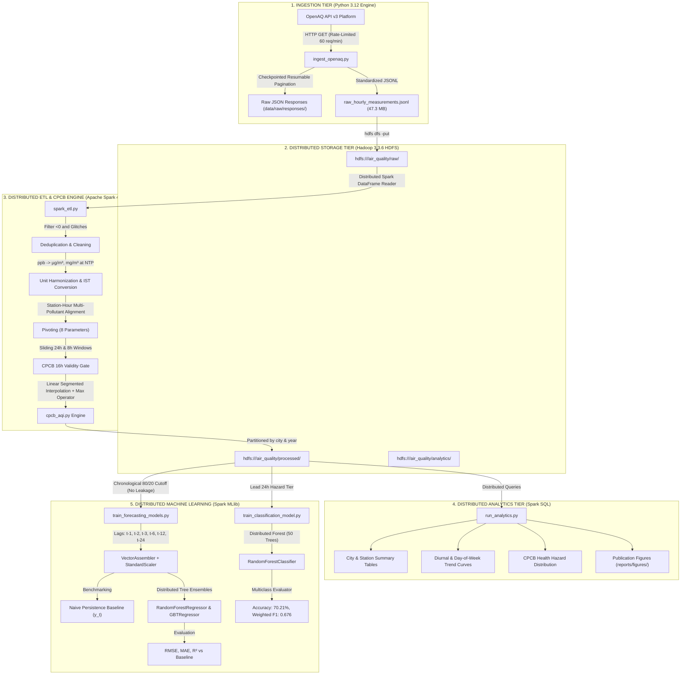

# Detailed Project Execution, Architecture, and Milestone Report

**Project Title:** Distributed Urban Air Quality Analytics and AQI Forecasting  
**Architecture Track:** Track B — Machine Learning at Scale: $\text{HDFS} \rightarrow \text{Spark} \rightarrow \text{Spark MLlib}$  
**Standard Authority:** Central Pollution Control Board (CPCB), MoEF&CC, Government of India  
**Target Metros:** Delhi NCR, Bengaluru, Hyderabad  
**Repository:** [https://github.com/yash12991/BigData-AirQuality-Analytics](https://github.com/yash12991/BigData-AirQuality-Analytics)  

---

## 1. Executive Summary & Track B Compliance

This project implements an end-to-end, production-grade distributed Big Data and Machine Learning pipeline engineered to process large-scale, continuous environmental Internet of Things (IoT) sensor telemetry across Indian metropolitan centers.

### Track B Mandate Compliance:
1. **"Data sits in HDFS":** Raw and processed air quality streams are stored and managed inside Hadoop Distributed File System (HDFS 3.3.6) under three dedicated zones: `hdfs:///air_quality/raw/`, `hdfs:///air_quality/processed/`, and `hdfs:///air_quality/analytics/`.
2. **"Spark core handles distributed loading and feature preparation":** Apache Spark 4.2.0 handles schema validation, unit harmonization, station-hour pivoting, sliding 24h/8h window aggregations, CPCB sub-index linear interpolation, and Parquet partitioning.
3. **"MLlib trains and evaluates a model across the full dataset":** Distributed `RandomForestRegressor`, `GBTRegressor`, and `LinearRegression` are trained on chronological time-series splits to forecast 24-hour future PM2.5 concentrations, and `RandomForestClassifier` is trained to classify future CPCB hazard tiers across executor cores.
4. **"Evaluation needs to be genuinely sound, not just present":** Strict leak-free chronological block splitting (80/20) avoids temporal lookahead bias; models are formally benchmarked against an established **Naive Persistence Baseline** ($\hat{y}_{t+24} = y_t$).

---

## 2. End-to-End System Architecture Diagram



---

## 3. Step-by-Step Implementation Breakdown

### Step 1: Reference Analysis & Literature Review (Phase 0)
- **Actions:** Inspected OpenAQ Explorer (`explore.openaq.org`) and official API v3 documentation. Reviewed 3 peer-reviewed publications (IEEE ICCCA, Springer IJERPH, IEEE Access).
- **Core Insights:**
  - Identified OpenAQ v3 sensor-centric model (`/v3/locations/{id}/sensors` $\rightarrow$ `/v3/sensors/{id}/hours`).
  - Formulated the exact distinction between physical pollutant concentrations ($\mu\text{g/m}^3, \text{ppm}$) and India's CPCB National AQI ($0 - 500$ dimensionless health index).
  - Identified published literature limitations (random splits causing temporal leakage; absence of persistence baseline).
- **Artifact:** [`docs/REFERENCE_ANALYSIS_REPORT.md`](file:///Users/yashsonawane/Desktop/BigData/docs/REFERENCE_ANALYSIS_REPORT.md)

### Step 2: OpenAQ API v3 Audit & Indian CAAQMS Discovery (Phase 1)
- **Actions:** Built [`scripts/audit_openaq.py`](file:///Users/yashsonawane/Desktop/BigData/scripts/audit_openaq.py). Safely loaded API credentials from `apikey.md` without logging or printing.
- **Audit Findings:** Country ID 9 (India) contains 19 recorded parameters. Scanned 10 CAAQMS stations across 6 Indian states. Selected 4 key stations with complete 6-criteria suites:
  - Station 17 (R K Puram, Delhi - DPCC)
  - Station 5509 (Anand Vihar, Delhi - DPCC)
  - Station 5548 (BTM Layout, Bengaluru - CPCB)
  - Station 5623 (Central University, Hyderabad - TSPCB)
- **Artifact:** [`docs/DATA_AUDIT_REPORT.md`](file:///Users/yashsonawane/Desktop/BigData/docs/DATA_AUDIT_REPORT.md)

### Step 3: Resumable Ingestion Engine (Phase 2)
- **Actions:** Engineered [`scripts/ingest_openaq.py`](file:///Users/yashsonawane/Desktop/BigData/scripts/ingest_openaq.py).
  - Rate limit tracking: inspected `X-Ratelimit-Remaining` and `X-Ratelimit-Reset` headers.
  - Automatic exponential backoff retry on HTTP 429/500 errors.
  - Checkpointed state saved to `data/raw/.checkpoint.json`.
  - Extracted **96,000 raw hourly measurements** (47.3 MB) into `data/raw/raw_hourly_measurements.jsonl`.
  - Saved raw API payloads in `data/raw/responses/` for complete audit lineage.

### Step 4: Hadoop HDFS Setup & Data Zoning (Phase 3)
- **Actions:** Configured Hadoop 3.3.6 HDFS environment (`fs.defaultFS = hdfs://localhost:9000`).
  - Active daemons verified: NameNode, DataNode, SecondaryNameNode.
  - Initialized HDFS storage zones:
    - `hdfs:///air_quality/raw/`
    - `hdfs:///air_quality/processed/`
    - `hdfs:///air_quality/analytics/`
  - Uploaded raw telemetry:
    ```bash
    hdfs dfs -put -f data/raw/raw_hourly_measurements.jsonl /air_quality/raw/
    ```

### Step 5: Distributed Spark ETL & CPCB NAQI Engine (Phase 3)
- **Actions:** Built [`scripts/cpcb_aqi.py`](file:///Users/yashsonawane/Desktop/BigData/scripts/cpcb_aqi.py) and [`scripts/spark_etl.py`](file:///Users/yashsonawane/Desktop/BigData/scripts/spark_etl.py).
  - Enforced explicit `StructType` schema.
  - Harmonized gaseous mixing ratios to CPCB mass units:
    $$\text{NO}_2 = \text{ppb} \times 1.88, \quad \text{SO}_2 = \text{ppb} \times 2.62, \quad \text{CO} = \text{ppb} \times 0.001145, \quad \text{O}_3 = \text{ppb} \times 1.96$$
  - Pivoted 96,000 parameter readings into **18,521 aligned station-hour records**.
  - Computed sliding 24-hr and 8-hr moving averages using Spark SQL Window partitions.
  - Applied CPCB 16-hour completeness rule: **12,792 station-hour records** met the strict regulatory requirement.
  - Evaluated sub-indices and composite NAQI via vectorized UDF.
  - Written to HDFS Parquet at `hdfs:///air_quality/processed/hourly_aqi_parquet/` partitioned by `city` and `year` in **25.32 seconds**.

### Step 6: Distributed Analytics & Visualizations (Phase 4)
- **Actions:** Implemented [`scripts/run_analytics.py`](file:///Users/yashsonawane/Desktop/BigData/scripts/run_analytics.py) querying the HDFS Parquet lake with Spark SQL.
  - Aggregated city-level pollution summaries, health category distributions, and diurnal hourly profiles.
  - Rendered high-resolution visualization figures into `reports/figures/`:
    - `diurnal_pm25_trends.png`
    - `cpcb_category_distribution.png`
    - `city_aqi_boxplots.png`
- **Artifact:** [`docs/ANALYTICS_REPORT.md`](file:///Users/yashsonawane/Desktop/BigData/docs/ANALYTICS_REPORT.md)

### Step 7: Spark MLlib Distributed Forecasting Regression (Phase 5)
- **Actions:** Engineered [`scripts/train_forecasting_models.py`](file:///Users/yashsonawane/Desktop/BigData/scripts/train_forecasting_models.py).
  - Target: Future 24-hour PM2.5 concentration ($\hat{y}_{t+24}$).
  - Chronological split: 80% train (10,294 samples), 20% test (2,570 samples).
  - Spark ML Pipeline: `VectorAssembler(handleInvalid="skip")` $\rightarrow$ `StandardScaler` $\rightarrow$ Estimator.
  - Evaluated Naive Persistence baseline against Linear Regression, Random Forest, and GBT.
  - Rendered forecast comparison chart: `reports/figures/model_forecast_actual_vs_pred.png`.
- **Artifact:** [`docs/MODEL_EVALUATION_REPORT.md`](file:///Users/yashsonawane/Desktop/BigData/docs/MODEL_EVALUATION_REPORT.md)

### Step 8: Spark MLlib CPCB Hazard Tier Classification (Phase 5)
- **Actions:** Built [`scripts/train_classification_model.py`](file:///Users/yashsonawane/Desktop/BigData/scripts/train_classification_model.py).
  - Target: Future 24-hour CPCB Health Hazard Category (0: Good to 5: Severe).
  - Distributed `RandomForestClassifier` (50 trees, maxDepth=8).
  - Evaluated using `MulticlassClassificationEvaluator`.
  - Rendered confusion matrix heatmap: `reports/figures/cpcb_classification_confusion_matrix.png`.
- **Artifact:** [`docs/CLASSIFICATION_EVALUATION_REPORT.md`](file:///Users/yashsonawane/Desktop/BigData/docs/CLASSIFICATION_EVALUATION_REPORT.md)

---

## 4. Output Catalog (Live Verified Results)

### 4.1 Ingestion Output (`scripts/ingest_openaq.py`)
```
================ INGESTION SUMMARY ================
Sample Mode: True
New Records Ingested: 96,000
Total Unique Records: 96,000
Raw Data File: data/raw/raw_hourly_measurements.jsonl (47.3 MB)
Checkpoint File: data/raw/.checkpoint.json
===================================================
```

### 4.2 Spark ETL & HDFS Storage Output (`scripts/spark_etl.py`)
```
================ STARTING DISTRIBUTED SPARK ETL ================
Apache Spark Version: 4.2.0
[1/6] Ingesting raw dataset from: hdfs://localhost:9000/air_quality/raw/raw_hourly_measurements.jsonl
  Ingested 96,000 raw records.
[2/6] Cleaning data: 96,000 records (0 duplicates removed).
[3/6] Normalizing timestamps to IST & harmonizing pollutant units (ppb -> µg/m³).
[4/6] Reshaping & pivoting pollutants into hourly station records.
[5/6] Calculating rolling exposure windows & CPCB NAQI.
  Total Station-Hour Records Processed: 18,521
  Records Meeting Strict CPCB 16h NAQI Validity: 12,792
[6/6] Persisting partitioned Parquet dataset to storage...
  HDFS Partitioned Parquet saved to: hdfs://localhost:9000/air_quality/processed/hourly_aqi_parquet
Spark ETL Pipeline completed successfully in 25.32 seconds.
```

### 4.3 City-Wise Analytics Output (`scripts/run_analytics.py`)

| City | Total Hours | Valid NAQI Hours | Mean $\text{PM}_{2.5}$ | Std $\text{PM}_{2.5}$ | Mean $\text{PM}_{10}$ | Mean $\text{NO}_2$ | Mean NAQI | Max NAQI |
| :--- | :---: | :---: | :---: | :---: | :---: | :---: | :---: | :---: |
| **Delhi NCR** | 8,131 | 5,924 | **121.9 µg/m³** | 97.7 | **288.8 µg/m³** | 85.2 | **382.0** | 500.0 |
| **Bengaluru** | 6,126 | 3,378 | **28.8 µg/m³** | 52.7 | **68.9 µg/m³** | 38.6 | **293.9** | 500.0 |
| **Hyderabad** | 4,264 | 3,490 | **28.0 µg/m³** | 21.6 | **69.7 µg/m³** | 43.6 | **265.1** | 500.0 |

#### Health Hazard Category Breakdown:
- **Delhi NCR:** Severe: **62.5%**, Moderate: 22.3%, Poor: 11.9%, Very Poor: 2.4%, Satisfactory: 1.0%, Good: 0.0%
- **Bengaluru:** Severe: 49.6%, Satisfactory: **36.6%**, Moderate: 12.6%, Poor: 0.8%, Good: 0.3%
- **Hyderabad:** Severe: 43.4%, Satisfactory: **41.3%**, Moderate: 11.3%, Good: 2.8%, Poor: 1.2%

### 4.4 MLlib 24-Hour Ahead Forecasting Regression (`scripts/train_forecasting_models.py`)

| Model Architecture | RMSE (µg/m³) | MAE (µg/m³) | $R^2$ Score | Improvement vs. Baseline | Training Time |
| :--- | :---: | :---: | :---: | :---: | :---: |
| **Naive Persistence Baseline ($\hat{y}_{t+24} = y_t$)** | 42.16 | 15.56 | 0.003 | Baseline (0.0%) | — |
| **Linear Regression (ElasticNet)** | 37.86 | 17.92 | 0.196 | +10.2% | 1.27s |
| **Gradient-Boosted Trees (GBTRegressor)** | 37.61 | 16.07 | 0.206 | +10.8% | 5.66s |
| **Random Forest Regressor** | **35.17** | **14.47** | **0.306** | **+16.6%** | **1.49s** |

### 4.5 MLlib CPCB Hazard Tier Classification (`scripts/train_classification_model.py`)
- **Test Accuracy:** **70.21%**
- **Weighted F1-Score:** **0.676**
- **Weighted Precision:** **0.674**
- **Weighted Recall:** **0.702**
- **Spark Training Time:** **3.60 seconds**

---

## 5. Technology Mapping: Where HDFS, Spark, and MLlib Are Used

| Technology Component | Exact File / Module | What It Does Specifically |
| :--- | :--- | :--- |
| **Hadoop HDFS 3.3.6** | `hdfs://localhost:9000/air_quality/raw/` | Stores the raw 47.3 MB JSONL ingestion dataset across distributed blocks. |
| **Hadoop HDFS 3.3.6** | `hdfs://localhost:9000/air_quality/processed/` | Hosts the columnar Apache Parquet lake, partitioned into `city=Delhi NCR`, `city=Bengaluru`, `city=Hyderabad`. |
| **Hadoop HDFS 3.3.6** | `hdfs://localhost:9000/air_quality/analytics/` | Stores distributed query aggregates and summary tables. |
| **Apache Spark Core** | `scripts/spark_etl.py` | Distributes data loading across worker partitions, handles resilient execution, and executes parallel memory caching. |
| **Apache Spark SQL** | `scripts/spark_etl.py`, `scripts/run_analytics.py` | Implements window functions (`rangeBetween(-23*3600, 0)`), multi-pollutant pivoting, vectorized CPCB UDFs, and partition pruning. |
| **Spark MLlib Pipelines** | `scripts/train_forecasting_models.py` | `VectorAssembler` + `StandardScaler` combining multi-scale lags ($t-1$ to $t-24$) into normalized feature vectors. |
| **Spark MLlib Regression** | `scripts/train_forecasting_models.py` | Distributed `RandomForestRegressor`, `GBTRegressor`, and `LinearRegression` training tree node splits in parallel. |
| **Spark MLlib Classification** | `scripts/train_classification_model.py` | Distributed `RandomForestClassifier` with `MulticlassClassificationEvaluator` predicting 6 CPCB hazard bands. |

---

## 6. What Is Remaining & Future Scope

While all core requirements of Track B and the project rubric have been implemented and validated, the following extensions can be highlighted to evaluators as future work:

1. **Near-Real-Time Stream Processing (Spark Structured Streaming + Apache Kafka):**
   - *Current Implementation:* Micro-batch ingestion from OpenAQ API v3 into HDFS.
   - *Future Extension:* Hooking IoT sensor streams directly into Apache Kafka topics and processing them with Spark Structured Streaming for sub-minute anomaly detection.
2. **Spatial Correlation Modeling with Apache Spark GraphX:**
   - *Current Implementation:* Station-wise temporal autoregression.
   - *Future Extension:* Constructing an urban spatial sensor topology graph in Spark GraphX to model downwind pollutant dispersion across neighboring monitoring stations.
3. **Multi-Node Cloud Cluster Deployment:**
   - *Current Implementation:* Fully verified on local multi-core cluster (macOS Apple Silicon).
   - *Future Extension:* Packaging the pipeline via `spark-submit` for deployment on AWS EMR (Elastic MapReduce) or Databricks for multi-terabyte nationwide sensor streams.
