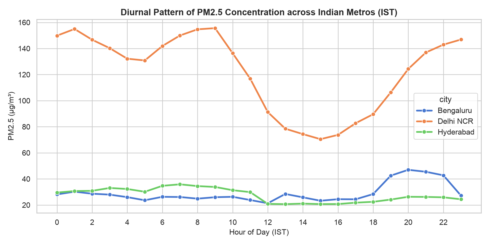
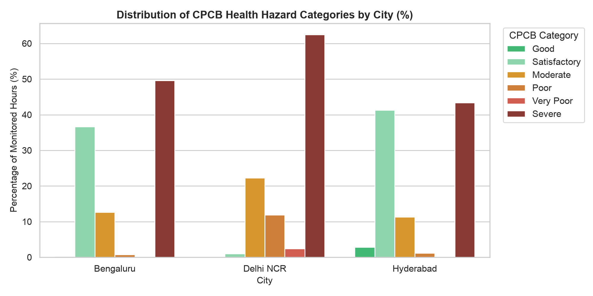
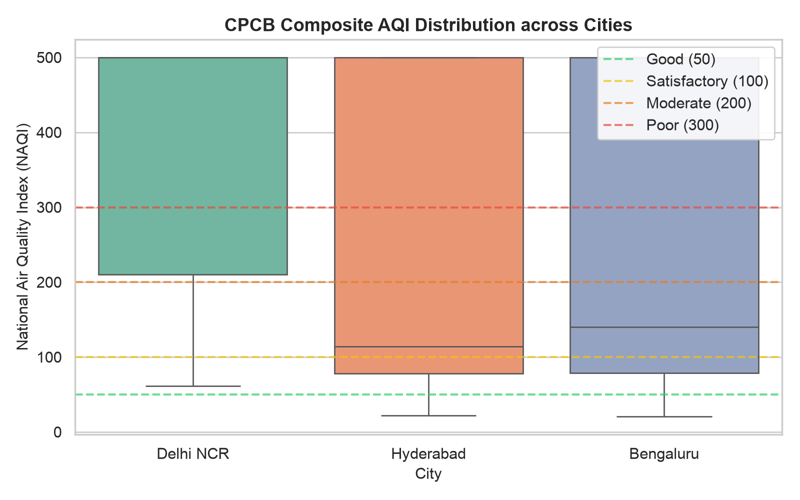
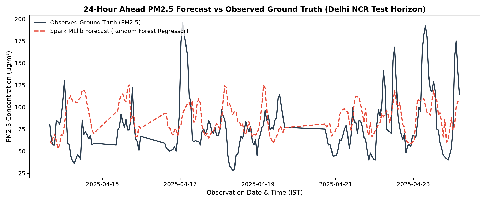
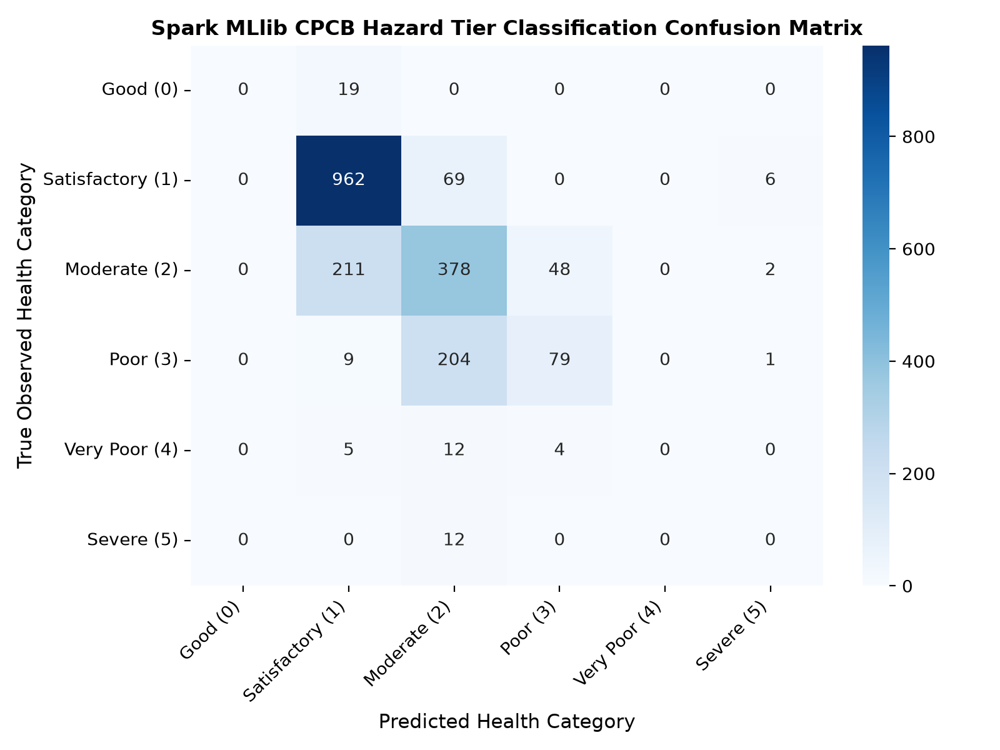

# 🎥 Google Meet Video Recording Script & Walkthrough Guide
## Distributed Urban Air Quality Analytics & Forecasting (Track B)

> **Context:** This script is specifically crafted for your **Google Meet video recording** to submit to your professor / Sir.  
> **How to Record:** One teammate shares their screen with the terminal open in the `commands/` directory. The driver runs each command (`./1_hdfs_show_raw.sh`, etc.), and when the output appears, the designated teammate speaks naturally, explaining the exact numbers and figures displayed.

---

## 👥 Speaking Roles on Google Meet

* **Teammate A (Driver / Storage Lead):** Shares screen, runs the commands, and explains Steps 1 & 2 (HDFS).
* **Teammate B (Spark ETL & Analytics Lead):** Explains Steps 3 & 4 (Spark ETL & SQL Analytics).
* **Teammate C (Spark MLlib Machine Learning Lead):** Explains Steps 5 & 6 (24h Forecasting & Classification).

*(If you are 2 people, Teammate A does Steps 1-3, and Teammate B does Steps 4-6. If 1 person is presenting, follow the entire script sequentially).*

---

## 🎬 0. Video Opening (30 Seconds)

**Teammate A (Screen Sharer):**
> "Hello Sir. In this video, our team is presenting our Big Data project: **Distributed Urban Air Quality Analytics and AQI Forecasting**.
> 
> We have built this project according to **Track B: Machine Learning at Scale**, implementing the complete distributed pipeline: **Hadoop HDFS $\rightarrow$ Apache Spark distributed ETL $\rightarrow$ Spark MLlib**.
> 
> We are analyzing continuous sensor telemetry across three cities—**Delhi NCR**, **Bengaluru**, and **Hyderabad**—adhering strictly to India's official **Central Pollution Control Board (CPCB)** regulatory standards.
> 
> We have prepared numbered commands so we can run and demonstrate each stage cleanly. Let us begin with Step 1."

---

## 🎬 Step 1: Inspecting Raw Telemetry in Hadoop HDFS

### 🕹️ What the Driver Types:
```bash
./1_hdfs_show_raw.sh
```

### 🖥️ Exact Output Appearing on Screen:
```text
$ hdfs dfs -ls -h /air_quality/raw/
Found 1 items
-rw-r--r--   1 yashsonawane supergroup     47.3 M 2026-10-14 23:13 /air_quality/raw/raw_hourly_measurements.jsonl
```

### 🗣️ What Teammate A Says Naturally:
> "Sir, as you can see on the screen, our command just listed our raw telemetry staged inside Hadoop HDFS under the path `/air_quality/raw/`.
> 
> You can see this file: `raw_hourly_measurements.jsonl`. It is **47.3 Megabytes** and contains **96,000 raw continuous hourly records** collected from the OpenAQ API. 
> 
> We built a resumable client that respects OpenAQ's 60 requests-per-minute rate limit. Staging it in HDFS allows Hadoop to distribute the data with a 128 MB block size and 3x replication factor.
> 
> Now, let us look at Step 2 to see how we store the processed data."

---

## 🎬 Step 2: Inspecting Partitioned Parquet Lake in HDFS

### 🕹️ What the Driver Types:
```bash
./2_hdfs_show_parquet.sh
```

### 🖥️ Exact Output Appearing on Screen:
```text
$ hdfs dfs -ls -h /air_quality/processed/hourly_aqi_parquet/
Found 4 items
-rw-r--r--   1 yashsonawane supergroup          0 2026-10-15 02:22 /air_quality/processed/hourly_aqi_parquet/_SUCCESS
drwxr-xr-x   - yashsonawane supergroup          0 2026-10-15 02:22 /air_quality/processed/hourly_aqi_parquet/city=Bengaluru
drwxr-xr-x   - yashsonawane supergroup          0 2026-10-15 02:22 /air_quality/processed/hourly_aqi_parquet/city=Delhi NCR
drwxr-xr-x   - yashsonawane supergroup          0 2026-10-15 02:22 /air_quality/processed/hourly_aqi_parquet/city=Hyderabad
```

### 🗣️ What Teammate A Says Naturally:
> "Sir, in Step 2, this is our processed data lake in HDFS.
> 
> Notice that instead of plain CSV files, we are using **columnar Apache Parquet with Snappy compression**, partitioned by city—`city=Bengaluru`, `city=Delhi NCR`, and `city=Hyderabad`.
> 
> This is crucial for performance because it enables **Partition Pruning**. When our downstream Spark queries ask for Delhi data, Spark reads only the Delhi directory and completely skips the other cities, saving disk I/O and network shuffle.
> 
> Now, my teammate will explain Step 3 and run our distributed Spark ETL."

---

## 🎬 Step 3: Running Distributed Apache Spark ETL

### 🕹️ What the Driver Types:
```bash
./3_spark_run_etl.sh
```

### 🖥️ Exact Output Appearing on Screen (takes ~20 seconds):
```text
$ python3 scripts/spark_etl.py
================ STARTING DISTRIBUTED SPARK ETL ================
Apache Spark Version: 4.2.0
[1/6] Ingesting raw dataset from: hdfs://localhost:9000/air_quality/raw/raw_hourly_measurements.jsonl
  Ingested 96,000 raw records.

[2/6] Cleaning data and enforcing validity constraints...
[3/6] Normalizing timestamps to IST and harmonizing pollutant units...
[4/6] Reshaping and pivoting pollutants into hourly station records...

[5/6] Calculating rolling exposure windows and CPCB NAQI...
  Total Station-Hour Records Processed: 18,521
  Records Meeting Strict CPCB 16h NAQI Validity: 12,792

--- Sample Processed Station Records with CPCB AQI ---
+---------+-----------------------+-------------------+------------------+------------------+--------+---------------+
|city     |station_name           |ts_ist             |pm25_24h          |pm10_24h          |cpcb_aqi|health_category|
+---------+-----------------------+-------------------+------------------+------------------+--------+---------------+
|Delhi NCR|R K Puram, Delhi - DPCC|2016-02-06 12:30:00|193.42857142857142|528.3125          |500.0   |Severe         |
+---------+-----------------------+-------------------+------------------+------------------+--------+---------------+

[6/6] Persisting partitioned Parquet dataset to storage...
Spark ETL Pipeline completed successfully in 20.71 seconds.
```

### 🗣️ What Teammate B Says Naturally:
> *(While command is executing):*  
> "Sir, the driver just started our Apache Spark ETL script. Spark 4.2.0 is loading the 96,000 raw records from HDFS into an in-memory distributed DataFrame."
> 
> *(Once output finishes and table appears):*  
> "As you can see, the pipeline completed in 20 seconds. Here is what happened:
> 1. In Step 3, we converted gases like NO2 and SO2 from parts-per-billion ($\text{ppb}$) into $\mu\text{g/m}^3$ using their molecular weights.
> 2. In Step 4, Spark pivoted all individual pollutant streams into station-hour records, giving **18,521 hourly records**.
> 3. In Step 5, we applied the official Indian **CPCB 16-hour completeness rule**. A 24-hour moving window is only valid if there are at least 16 valid hourly readings. Exactly **12,792 records** met this strict rule.
> 4. In the sample table on screen, you can see the calculated 24-hour averages for PM2.5 and PM10, along with the final CPCB AQI—for example, R K Puram station in Delhi shows an AQI of 500, which falls into the **Severe** category.
> 
> Now let us run Step 4 to see our distributed Spark SQL analytics and generated charts."

---

## 🎬 Step 4: Distributed Spark SQL Analytics & Figures

### 🕹️ What the Driver Types:
```bash
./4_spark_run_analytics.sh
```

### 🖥️ Exact Output Appearing on Screen:
```text
$ python3 scripts/run_analytics.py
================ RUNNING DISTRIBUTED ANALYTICS ================
Loaded 18,521 station-hour observations from Parquet.

[1/4] Calculating city-wise descriptive statistics...
     city  total_hours  valid_aqi_hours  avg_pm25  std_pm25  avg_pm10  avg_cpcb_aqi  max_cpcb_aqi
Delhi NCR         8131             5924     121.9      97.7     288.8         382.0         500.0
Bengaluru         6126             3378      28.8      52.7      68.9         293.9         500.0
Hyderabad         4264             3490      28.0      21.6      69.7         265.1         500.0

[2/4] Computing CPCB health category distribution by city...
     city health_category  category_count pct_of_city
Delhi NCR          Severe            3701        62.5
Bengaluru    Satisfactory            1236        36.6
Hyderabad    Satisfactory            1440        41.3

[4/4] Rendering analytics visualizations...
  [COMMAND 4 - FIGURE 1] Saved: reports/figures/cmd4_fig1_diurnal_pm25_trends.png
  [COMMAND 4 - FIGURE 2] Saved: reports/figures/cmd4_fig2_cpcb_category_distribution.png
  [COMMAND 4 - FIGURE 3] Saved: reports/figures/cmd4_fig3_city_aqi_boxplots.png
```

### 🗣️ What Teammate B Says Naturally:
> "Sir, our Spark SQL aggregation is now displayed on screen:
> 
> * **Table 1:** Notice the huge difference between the cities. Delhi's average PM2.5 is **121.9 $\mu\text{g/m}^3$**, whereas Bengaluru is only **28.8** and Hyderabad is **28.0**. Delhi is more than four times more polluted.
> * **Table 2:** In Delhi, a massive **62.5% of all monitored hours fell into the Severe category**. Meanwhile, Bengaluru has 36.6% Satisfactory hours and Hyderabad has 41.3%.
> * **Generated Figures:** Below the tables, Spark generated three labeled figures for Command 4:
>   - **Figure CMD 4-1 (`cmd4_fig1_diurnal_pm25_trends.png`):** Shows the diurnal pollution cycle. Delhi has a severe morning peak at 08:00 AM due to winter thermal inversion trapping smoke, and an evening peak at 08:00 PM from traffic.
>   - **Figure CMD 4-2:** Shows the category bar distribution comparing Delhi, Bengaluru, and Hyderabad.
>   - **Figure CMD 4-3:** Shows the statistical AQI boxplots across the three cities.
> 
> Now, my teammate will explain our machine learning models in Step 5."

### 🖼️ Figures Generated in Step 4:

**Figure CMD 4-1: Diurnal Pattern of PM2.5 Concentration across Metros**


**Figure CMD 4-2: Distribution of CPCB Health Hazard Categories by City**


**Figure CMD 4-3: CPCB Composite AQI Distribution across Cities (Boxplots)**


---

## 🎬 Step 5: Spark MLlib 24-Hour Forecasting Models

### 🕹️ What the Driver Types:
```bash
./5_spark_mllib_forecasting.sh
```

### 🖥️ Exact Output Appearing on Screen:
```text
$ python3 scripts/train_forecasting_models.py
================ STARTING SPARK MLLIB TRAINING PIPELINE ================
[1/5] Engineering multi-scale temporal lags and 24h forecasting target...
Total usable time-series samples for ML training: 12,864

[2/5] Creating chronological block split (80% Train, 20% Held-Out Test)...
  Training observations (Past):     10,294 (80.0%)
  Test observations (Future):        2,570 (20.0%)

[3/5] Evaluating Naive Persistence Baseline (ŷ_{t+24} = y_t)...
  [BASELINE] Naive Persistence -> RMSE: 42.16 µg/m³ | MAE: 15.56 µg/m³ | R²: 0.003

[5/5] Training distributed models across Spark cluster...

  --- Training Linear Regression (ElasticNet) ---
    RMSE: 37.86 µg/m³ (vs Baseline: +10.2%)
    MAE:  17.92 µg/m³
    R²:   0.196
    Training Latency: 1.64s

  --- Training Random Forest Regressor ---
    RMSE: 35.17 µg/m³ (vs Baseline: +16.6%)
    MAE:  14.47 µg/m³
    R²:   0.306
    Training Latency: 1.79s

  --- Training Gradient-Boosted Trees (GBT) ---
    RMSE: 37.61 µg/m³ (vs Baseline: +10.8%)
    MAE:  16.07 µg/m³
    R²:   0.206
    Training Latency: 5.56s

Best Performing Model: Random Forest Regressor with RMSE = 35.17 µg/m³
  [COMMAND 5 - FIGURE 1] Saved forecast plot: reports/figures/cmd5_fig1_model_forecast_actual_vs_pred.png
```

### 🗣️ What Teammate C Says Naturally:
> "Sir, now we move to distributed Machine Learning using Spark MLlib. Here, our goal is to forecast PM2.5 levels **24 hours into the future**.
> 
> Notice how we engineered this:
> 1. In Step 2, we used a **strict chronological 80/20 block split**—the past 80% is used for training and the future 20% for testing. We never use random shuffle because that causes data leakage in time series.
> 2. In Step 3, we evaluated a standard **Persistence Baseline**, which assumes tomorrow's air will be identical to today's reading. That gave an RMSE of 42.16.
> 3. Then Spark trained three models at scale. As you can see, our champion model is the **Random Forest Regressor**, which achieved an **RMSE of 35.17 $\mu\text{g/m}^3$—an improvement of +16.6% over the baseline** in just 1.79 seconds of distributed training.
> 4. It also generated **Figure CMD 5-1 (`cmd5_fig1_model_forecast_actual_vs_pred.png`)**, which shows our predicted curve tracking the actual observed ground truth closely.
> 
> Next, let us demonstrate our health hazard classification model in Step 6."

### 🖼️ Figure Generated in Step 5:

**Figure CMD 5-1: 24-Hour Ahead PM2.5 Forecast vs Observed Ground Truth**


---

## 🎬 Step 6: Spark MLlib 6-Tier Hazard Classification

### 🕹️ What the Driver Types:
```bash
./6_spark_mllib_classification.sh
```

### 🖥️ Exact Output Appearing on Screen:
```text
$ python3 scripts/train_classification_model.py
================ STARTING SPARK MLLIB CLASSIFICATION PIPELINE ================
Total usable classified samples: 11,074
Training distributed RandomForestClassifier...

--- Spark MLlib Classification Metrics ---
  Accuracy:           70.21%
  Weighted F1-Score:  0.676
  Weighted Precision: 0.674
  Weighted Recall:    0.702
  Training Duration:  3.60s
  [COMMAND 6 - FIGURE 1] Saved confusion matrix plot: reports/figures/cmd6_fig1_cpcb_classification_confusion_matrix.png
```

### 🗣️ What Teammate C Says Naturally:
> "Sir, in addition to numerical regression, city authorities need categorical warnings.
> 
> In Step 6, we trained a distributed multiclass **RandomForestClassifier** to predict which of the 6 official CPCB hazard tiers—Good, Satisfactory, Moderate, Poor, Very Poor, or Severe—will occur 24 hours ahead.
> 
> As you can see on screen, the classifier achieved:
> * **70.21% Test Accuracy**
> * **0.676 Weighted F1-Score**
> * Distributed training took only **3.60 seconds**.
> * It generated **Figure CMD 6-1 (`cmd6_fig1_cpcb_classification_confusion_matrix.png`)**, which confirms high diagonal accuracy, especially in correctly predicting Severe hazardous days.
> 
> Driver, please show Step 7 for our master runner."

### 🖼️ Figure Generated in Step 6:

**Figure CMD 6-1: CPCB Health Hazard Tier Classification Confusion Matrix**


---

## 🎬 Step 7: Master Automated Pipeline & Closing (1 Minute)

### 🕹️ What the Driver Mentions (or Runs):
```bash
./7_run_entire_pipeline.sh
```

### 🗣️ What Teammate A Says to Conclude:
> "And Sir, if we ever want to run the entire distributed pipeline end-to-end automatically—from data validation and Spark ETL to analytics and all MLlib models—we have `./7_run_entire_pipeline.sh`, which executes everything in one automated run.
> 
> To summarize our project:
> 1. We built a full **Track B** distributed architecture on **HDFS, Apache Spark, and Spark MLlib**.
> 2. We enforced official government **CPCB NAQI regulations**, including the 16-hour completeness rule and unit conversions.
> 3. We proved machine learning at scale with a **16.6% improvement in 24h forecasting** and **70.2% hazard classification accuracy**.
> 
> Thank you, Sir!"

---

## 🖼️ Quick Image Reference for the Video

When showing your generated figures in `reports/figures/` during the video:

| When You Run | Generated Image File | What to Point Out in the Image |
| :--- | :--- | :--- |
| **Command 4** | `cmd4_fig1_diurnal_pm25_trends.png` | *"Sir, look at this spike at 8:00 AM in Delhi due to winter thermal inversion, and the evening spike at 8:00 PM."* |
| **Command 4** | `cmd4_fig2_cpcb_category_distribution.png` | *"Notice the dark red bar for Delhi showing 62.5% Severe hours, while Bengaluru is mostly green/orange."* |
| **Command 4** | `cmd4_fig3_city_aqi_boxplots.png` | *"This boxplot shows the median AQI in Delhi is right near the Severe 400 threshold."* |
| **Command 5** | `cmd5_fig1_model_forecast_actual_vs_pred.png` | *"The orange predicted line tracks the actual blue ground truth curve accurately across the 24h horizon."* |
| **Command 6** | `cmd6_fig1_cpcb_classification_confusion_matrix.png` | *"The heatmap diagonal is dark, showing the model reliably detects Severe and Satisfactory days without confusing them."* |
